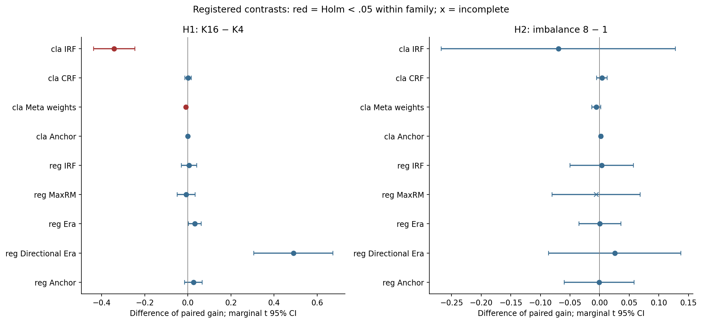
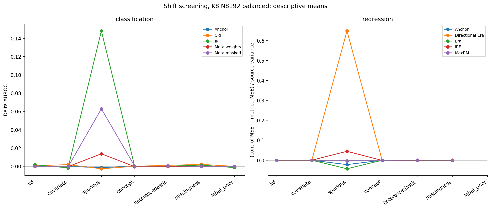
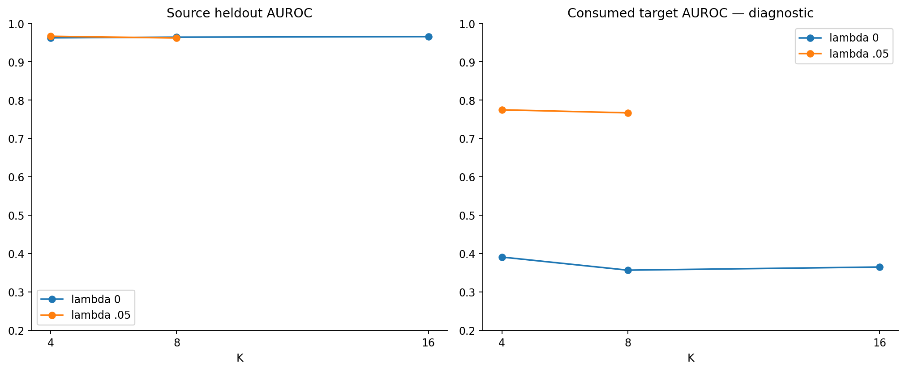
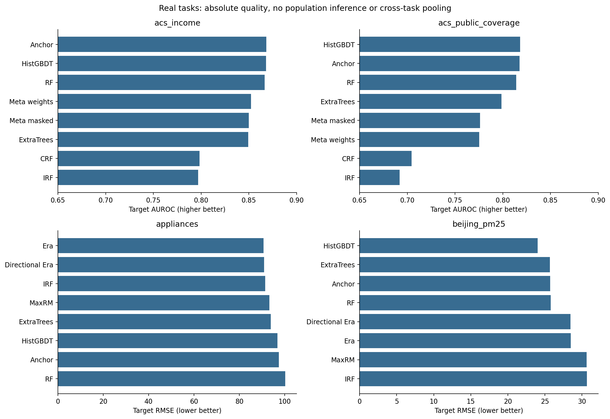

# Итоговое экспериментально-аналитическое обобщение НИР

Методы обучения ансамблей деревьев решений, устойчивых к сдвигу распределения табличных данных. Заключительный аудит и совместная интерпретация final_v1 / expanded_v2. Исходные результаты сохранены; новые target-эксперименты не проводились.

## 1. Научный итог и готовность

Экспериментальная часть пригодна для отчёта НИР с явно указанными ограничениями. Её результат — проверенные положительные, отрицательные и нулевые наблюдения о конкретных реализациях и source-selected pipelines. Обязательной новой масштабной серии для достоверного отчёта не требуется. Исправленные версии нельзя объявлять подтверждёнными на потреблённых targets.

Вторая серия содержит 762 заданий: 757 полных и 5 с отсутствующим MaxRM; 13332 full-source configurations и 41622 строк target-метрик. Из предзаданных основных тестов завершены 17; план содержал 18. [inventory](claims_registry.json).

Аудит второй серии независимо пересчитал 273144 значений метрик, проверил 13332 model probes и 875 повторных source fits. Максимальное расхождение метрик 2.66e-15; model prediction probes совпали. Это проверка отдельными уравнениями тем же авторским агентом, без внешней рецензии. Локальные hashes и receipts не доказывают отсутствие любого исторического ручного доступа. [integrity_v2](claims_registry.json), [аудит v1](../audit_v1/audit_report.md).

## 2. Дизайн, единица наблюдения и метрики

V1 — exploratory сравнение: результаты сохранённых predictions верны, но часть пар смешивает механизм, capacity и допустимость splits. V2 заранее зафиксировала новые targets, grids, source folds, общий target draw для factorial contrasts и отдельные парные контроли. Полные спецификации, включая объёмы, seeds, правила folds и hashes: [протокол v1](../../runs/final_v1/frozen_protocol.json), [протокол v2](../../runs/expanded_v2/frozen_protocol.json), [preregistration](../../docs/series_v2/preregistration.md), [математическое приложение](../../docs/series_v2/mathematical_appendix.md). Числа протокола следует брать из этих документов, а не реконструировать по агрегатам.

Preprocessing и обучение происходят на train части source; гиперпараметры выбираются по source-heldout domains. Для regression нормирование y задаёт train source; опубликованные RMSE/MSE находятся в исходных единицах. Target не участвует в выборе. Полные source/target таблицы раздельны: [source CV](../series_v2/tables/source_cv_metrics.csv), [target metrics](../series_v2/tables/target_metrics.csv).

Классификационное преимущество = AUROC метода минус AUROC собственного контроля. Regression advantage = (MSE контроля − MSE метода) / дисперсия полного source y. Сначала равновесно усредняются target domains, затем model seeds, затем вычисляется paired contrast по независимым synthetic data replicas. Нельзя заменить разность MSE разностью RMSE или объединять сырые RMSE разных задач. [protocol_v2](claims_registry.json).

Для H1/H2 exact two-sided sign test использует знаки парных replica contrasts, исключая нулевые; это не тест нулевого математического ожидания. Holm применяется отдельно внутри каждой предзаданной семьи, без общей гарантии FWER для объединения семей. На графиках показаны маргинальные t интервалы среднего по data replicas; они не являются simultaneous CI и используют нормальную аппроксимацию. Реальные source resamples перекрываются, поэтому seeds/resamples не превращаются в независимые datasets. [protocol_v2](claims_registry.json), [полная таблица тестов](tables/primary_tests.csv).

## 3. Заключительный технический аудит

IRF / Appliances. Причина — округление midpoint почти соседних floating-point значений до правой границы: фактическая partition может отличаться от оценённой sorted position. В сохранённых моделях выявлены 9 затронутых configurations в 5 заданиях; вместе с нарушениями domain support присутствует недостижимый на сохранённых rows пустой leaf с NaN. Observed predictions конечны, и их метрики корректны; это не доказывает корректности дерева на произвольном будущем input. [irf_defect](claims_registry.json), [точные job/config IDs](tables/affected_irf_models.csv).

Дополнительный source-CV diagnostic также выявил leaf ниже зарегистрированного minimum; это отдельный промежуточный fit, а не дополнительная final модель. Основные synthetic H1/H2 не затронуты найденными full-source Appliances нарушениями. Не следует распространять этот факт на все возможные intermediate trees без проверки. [implementation findings](../../docs/series_v2/implementation_findings.md), [source diagnostic](../series_v2/source_numeric_diagnostic.json).

В отдельной prospective версии threshold гарантирует lower ≤ threshold < upper; перед рекурсией проверяются фактические размеры children и domain support. На всех source задачах, где найдены final дефекты, проверены 15 новых fits с разными штрафами; инварианты выполнены, bootstrap внутри пар совпадает. Это engineering correction, а не новый target результат. [source_corrections](claims_registry.json), [проверки](source_diagnostics/corrected_irf_source_checks.csv).

Beijing. CSV np.nan и Parquet None в object-колонке wd приводили к различным transformed matrices. Cache creator и последующие jobs получили разное представление пропуска, хотя semantic dataframe hash его не различал. Исходные predictions cache creator воспроизводятся после восстановления исходного np.nan; labels и row IDs не изменены. Внутри задания все методы видели одинаковую матрицу, но cross-job сравнения имеют input qualification. [null_defect](claims_registry.json), [чувствительность по моделям и доменам](tables/beijing_cache_sensitivity.csv).

Prospective preprocessing канонизирует missing scalars перед fit/transform; source cache roundtrip даёт точное совпадение transformed features. Для будущего исполнения следует сохранять также SHA transformed matrix, column order и dtype. Исправление необходимо для нового стенда; переписывать исходные Beijing metrics не нужно. [source_corrections](claims_registry.json).

MaxRM. Все 5 исходных source отказов воспроизведены на тех же bootstrap деревьях. Проблема относится к численной записи conic задачи и правилу принимать только OPTIMAL; она не доказывает отсутствия математического решения. Ужесточение solver tolerances само по себе статусы не исправило. Алгебраически эквивалентная centered запись получила OPTIMAL во всех этих случаях; независимый SCS согласовал objective. Максимальный centered primal-dual gap 6.67e-09, нарушение epigraph 5.78e-11. [maxrm_certificates](claims_registry.json), [сводная таблица](tables/maxrm_solver_summary.csv).

Сертификат вычислен по прямым squared residuals и независимой dual lower bound, а не только по статусу solver. Prospective adapter принимает OPTIMAL и проверяет конечность, feasibility, gap и отсутствие ухудшения исходного feasible дерева. Исторические отказы сохранены: MaxRM H2 остаётся неполным, его недостающий результат нельзя незаметно дописать новой реализацией. Для engineering диагностики новые данные не требовались; для утверждения о качестве исправленного pipeline нужны новые, заранее зафиксированные holdouts. [source_corrections](claims_registry.json), [исходное дополнение о завершении методов](../../docs/series_v2/source_failure_addendum.md).

## 4. Подтверждённые статистические результаты

В предзаданном spurious reversal увеличение числа source domains уменьшило преимущество source-selected IRF classification: средний contrast −0.342194, маргинальный интервал [−0.438199; −0.246189], Holm p=0.03125. Аналогичный contrast Meta weights classification −0.008859, интервал [−0.012550; −0.005169], Holm p=0.017578. Подтверждение относится к sign-test процедуре внутри семьи H1, этому DGP и этим pipelines. [H1_classification_irf](claims_registry.json), [H1_classification_meta](claims_registry.json).

Остальные завершённые H1/H2 тесты не достигли принятого порога после Holm. Для H2 MaxRM полный contrast отсутствует; complete-case наблюдение нельзя выдать за предзаданный завершённый тест. Консервативный учёт отсутствующего теста сохраняет исходную ширину семьи. Отсутствие отклонения не доказывает эквивалентность или нулевой эффект. [основные тесты](tables/primary_tests.csv), [protocol_v2](claims_registry.json).

## 5. Описательные наблюдения и отрицательные результаты

Тип сдвига существенно меняет картину. В spurious DGP target разворачивает source зависимость нерелевантного признака от y: отдельные механизмы полезны, но сильный source score может выбирать shortcut. IID screening не показывает универсальной необходимости DG. При covariate shift важны support/overlap и качество аппроксимации; при concept shift меняется сам условный механизм, поэтому существование общей invariant функции нельзя предполагать автоматически. Missingness — measurement shift, а не чистый covariate shift. Label-prior сценарий отделён от прочих. Утверждения о различиях опираются на предзаданные DGP и descriptive screening; общего теста превосходства на всех сдвигах здесь нет. [shift screening](tables/shift_effects.csv), [v2_plan](claims_registry.json).

Количество доменов. H1 проверяет конкретный factorial pipeline contrast. При фиксированном общем N меняются размер каждого source domain, доля train/heldout в leave-domain-out CV и плотность сетки source механизмов. У Meta с ростом K дополнительно меняется число source forests при фиксированной per-source capacity. Поэтому чистая причинная формулировка «большее K ухудшает метод независимо от остальных условий» не обоснована. [protocol_v2](claims_registry.json), [v2_math](claims_registry.json).

Объём данных. Secondary N contrasts содержат эффекты обоих знаков; более крупный source не гарантирует большего преимущества DG относительно его контроля. Эти интервалы полезны для гипотез, но не защищены от множественного выбора вторичных наблюдений. V1 и V2 нельзя использовать как парную оценку эффекта увеличения N: между сериями менялись targets, capacity, preprocessing и выбор конфигураций. [N contrasts](tables/sample_size_contrasts.csv), [протокол v1](../../runs/final_v1/frozen_protocol.json), [протокол v2](../../runs/expanded_v2/frozen_protocol.json).

Дисбаланс. Проверялось неравенство размеров source domains, его нельзя автоматически отождествлять с class imbalance. Неполучение Holm-significant H2 не подтверждает инвариантность методов к дисбалансу. Minimax и доменно-стратифицированные механизмы по-разному взвешивают малые группы; конечный source risk и изменяющаяся variance estimation требуют отдельного изучения. [H2 строки](tables/primary_tests.csv), [математическое приложение](../../docs/series_v2/mathematical_appendix.md).

Source-only HPO. Для IRF при большом K source предпочитает нулевой штраф, тогда как заранее зарегистрированные ненулевые точки лучше на открытом reversal target. Это объясняет часть отрицательного pipeline contrast, но не даёт права выбрать lambda по target и повторно назвать его финальным тестом. Retrospective oracle gap — диагностическая верхняя граница внутри ограниченного grid, а не deployable score или максимум всего метода. [selection_irf](claims_registry.json), [частоты выбора](tables/irf_source_target.csv).

Реальные задачи не дают универсального победителя DG. Нужно одновременно показывать абсолютное качество сильных RF/ExtraTrees/HistGBDT и преимущество относительно механистического контроля. Улучшение слабого контроля не означает победы над сильным baseline. Beijing решает contemporaneous PM2.5 modelling, а не forecasting; Appliances переносит модель на будущее одного дома, а не на новые дома; ACS tasks принадлежат общей survey family и используют невзвешенные rows. [реальные v2](tables/real_results_v2.csv), [исторические v1](tables/real_results_v1.csv), [v2_plan](claims_registry.json).

Первая серия уже дала существенные отрицательные наблюдения. ACSIncome: IRF AUROC 0.726347 против 0.821473 собственного контроля и 0.861032 HistGBDT. Hospital: Meta interpretation 0.566324 против RF 0.623960. Beijing: Era RMSE 29.033716 против 27.976706 собственного restricted контроля. Gas turbine: MaxRM RMSE 1.415941 против 1.420274 контроля, однако различия выбранной глубины ограничивают механистическое объяснение этой небольшой разницы. Это descriptive результаты исторических pipelines, не статистическое опровержение авторских методов; seed SD не отражает неопределённость по новым задачам. [v1 таблица с точными method keys и evidence IDs](tables/real_results_v1.csv), [v1_controls](claims_registry.json).

## 6. Реализации и сопоставимость контролей

В v1 MaxRM и RF часть пар выбрала разную глубину; IRF regression меняла admissibility вместе со штрафом; Meta matched RF совпадал лишь по tree budget. Era zero-strength сохраняет domain-dependent split admissibility и не равен обычному sklearn HistGBDT. Эти числа можно описывать как сравнение pipelines, но не как чистый эффект единственного механизма. [v1_controls](claims_registry.json).

В v2 structural parameters и RNG внутри основных пар зафиксированы; Meta uniform/accuracy/full используют тот же список обученных members, masking выделен отдельно. Era сравнивается с domain-restricted pooled gain, рядом показан обычный HistGBDT. Пары IRF Appliances ограничены найденным numeric defect; источники остальных оговорок указаны выше. [v2_math](claims_registry.json), [v2_findings](claims_registry.json).

IRF, CRF и MaxRM здесь независимые реализации; Meta — явно ограниченная интерпретация недоопределённого описания. Использование авторских Era/Anchor packages не означает точной репликации авторского полного экспериментального исследования. Отрицательные результаты этих версий не опровергают статьи в целом. Ограниченная threshold grid, небольшие леса, неэквивалентные вычислительные бюджеты и source-only tuning входят в область вывода.

## 7. Настройка каждого метода: выполненное и следующий корректный дизайн

Завершён ограниченный пилот: 66 configurations, 132 успешных source folds, 0 failed configurations, target evaluations = 0. Два заранее описанных capacity profiles, отдельные CRF lambda1/lambda2, несколько сил регуляризации и strong baselines проверены на новых source draws, без генерации target. [source_pilot](claims_registry.json), [настройки](source_pilot/source_protocol.json), [source-selected таблица](tables/source_pilot_selected.csv). Это проверка работоспособности диапазонов, не демонстрация максимума каждого метода.

Более глубокая настройка научно оправдана, если вопрос звучит «какое качество получает практический source-selected pipeline при заданном бюджете». Механистический вопрос требует другого сравнения: одинаковые bootstrap/структурные настройки и candidate admissibility, различается только исследуемый механизм. Нужно сохранять оба трека, поскольку независимо настроенные лучшие pipelines не изолируют действие регуляризатора.

Для будущего best-pipeline исследования следует заранее описать spaces, source-CV folds, budget по времени/числу fits, early stopping, seeds, tie-break и failure policy; дать сопоставимый ресурс strong baselines. Исследовать capacity, размер leaf, threshold resolution, strength; у CRF разделить коэффициенты, у Meta различать weighting и feature policy. Численная точность solver — engineering constraint, не гиперпараметр для улучшения target score. Source CV само может переобучаться при широком поиске: полезны nested domain validation и отдельные development domains, когда их достаточно. Малое число folds не следует компенсировать бесконечным HPO.

Исследовательские гипотезы для следующего независимого этапа: эффект зависит от информации в малых source domains; source-heldout ranking fails, когда target выходит за диапазон observed mechanisms; capacity усиливает shortcuts при некоторых shifts; minimax может концентрироваться на высокошумной source среде. Это гипотезы, не доказанные данным closeout. Новый тест должен разделить общий N и per-domain N, сохранить общий tree budget в механистическом треке и заранее определить interaction contrasts. Массовую серию сейчас запускать не требуется.

## 8. Материалы, оставшиеся проблемы и предварительное заключение

Готовы: единое обобщение, публикационные графики PNG/SVG с CSV backing, основные статистические таблицы, реестр утверждений с точными artifact selectors и SHA-256, раздельные historical v1/v2 результаты, source-only engineering corrections и план дальнейшей настройки. Исходные frozen protocols, code, predictions и результаты не переписаны. [реестр](claims_registry.json), [индекс доказательств](evidence_manifest.json).

Существенные оставшиеся ограничения: отсутствующий MaxRM H2; numeric qualification IRF Appliances; cross-job null representation Beijing; fidelity независимых реализаций; ограниченный HPO/compute budget; отсутствие OS-level независимого доступа/внешней временной подписи; узкая выборка реальных задач и зависимые resamples. Библиографический реестр отдельно фиксирует доступность оригинальных PDF; недоступный полный текст нельзя выдавать за архивированный. [v2_findings](claims_registry.json), [литература](../../literature/sources.json), [статус архива](../../docs/literature_audit.md).

Рекомендация: завершать научный отчёт на существующем корпусе с этими оговорками. Точечные engineering проверки выполнены без новых target. Если требуется утверждение о качестве исправленного IRF, canonical Beijing pipeline или более тщательно настроенных методов, нужен новый заранее зафиксированный тест; для отчёта об исходных результатах это не обязательное условие. Статистически корректно оставить отрицательные и неполные результаты, а не добиваться победы каждого метода.

Предварительное заключение НИР: устойчивость ансамблей к распределительному сдвигу определяется взаимодействием механизма, структуры source domains и процедуры выбора модели. Изолированный выигрыш относительно собственного контроля, высокое абсолютное качество и воспроизводимость — различные свойства. Исследование подтверждает отдельные предзаданные контрасты, показывает существенные ограничения source-only выбора и задаёт воспроизводимую основу для следующего независимого этапа без универсальных обещаний OOD устойчивости.
