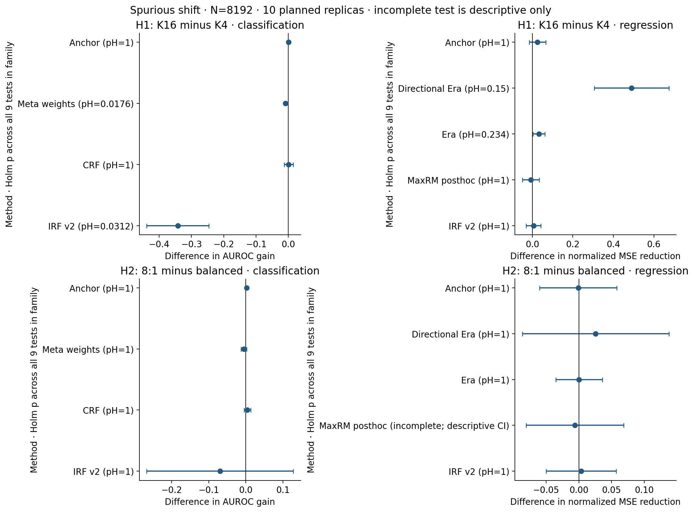
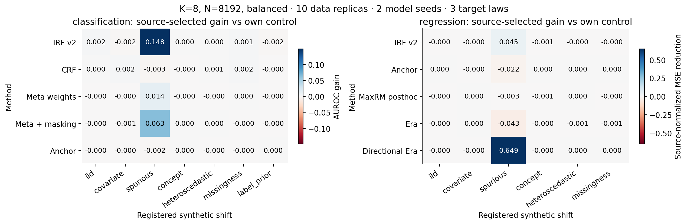
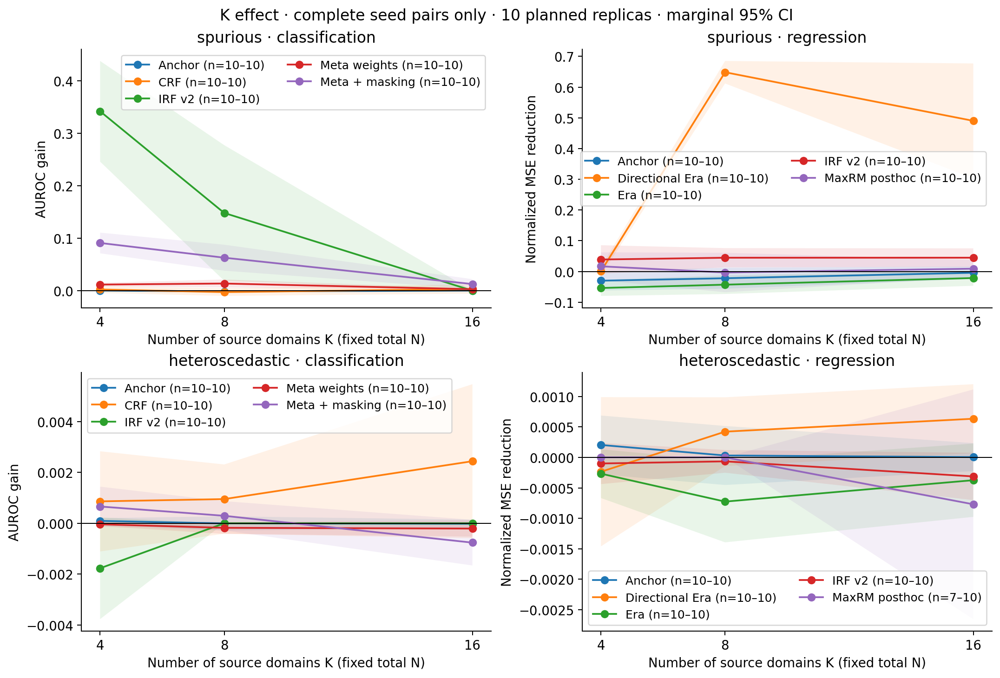
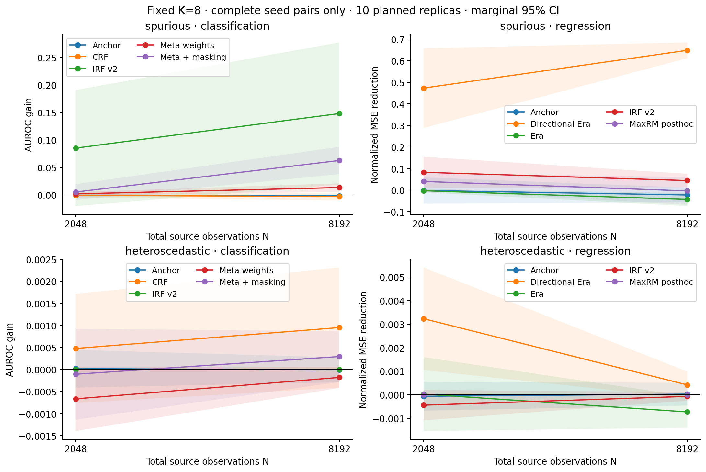
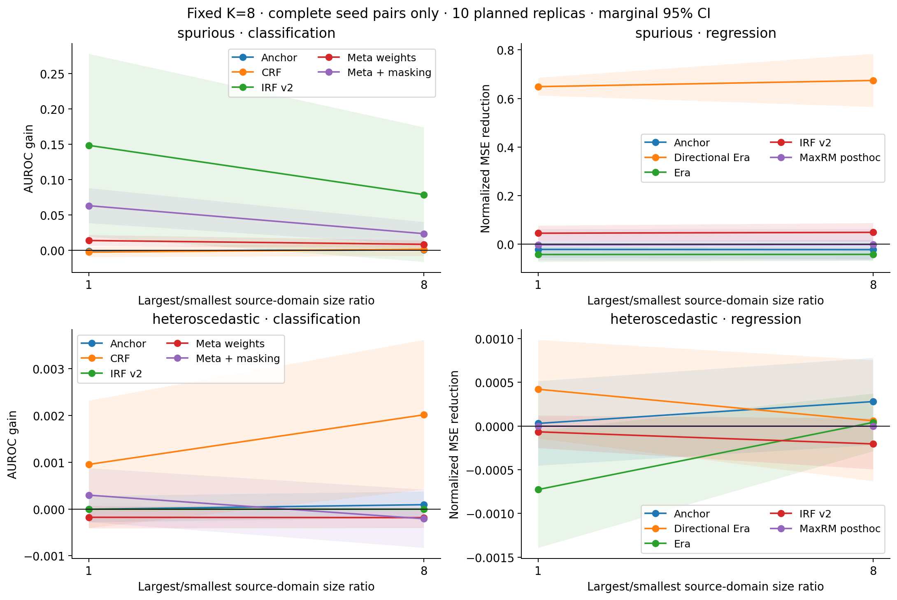
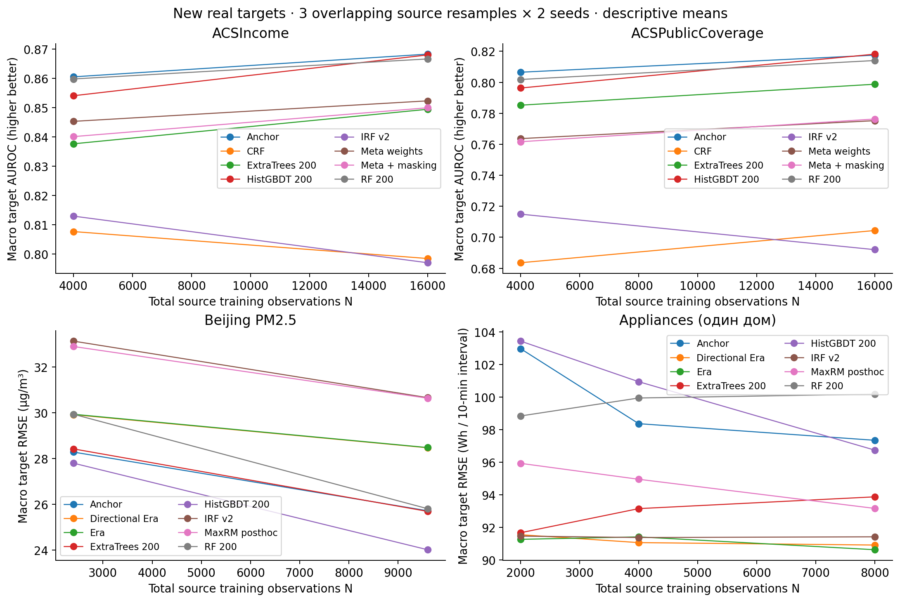
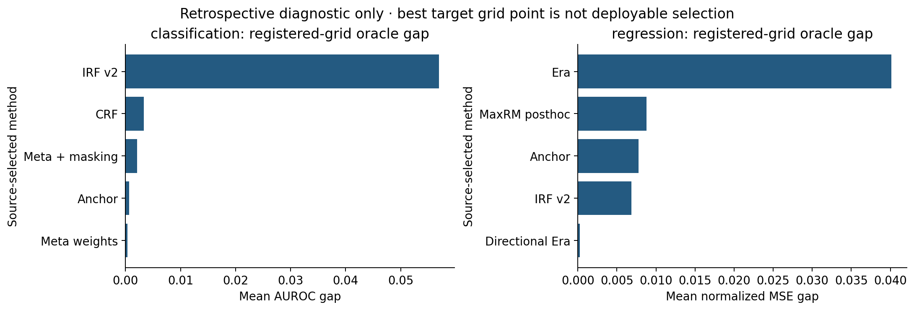
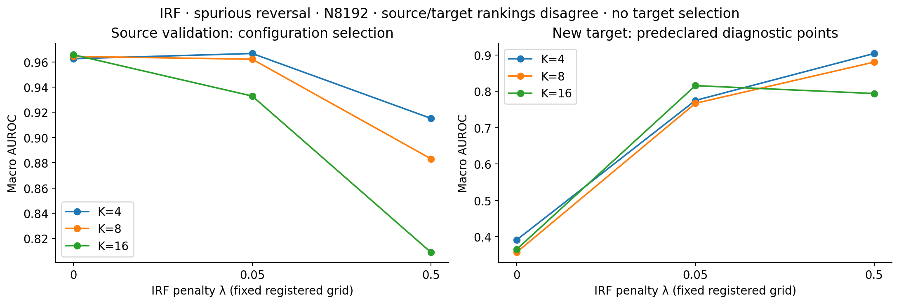
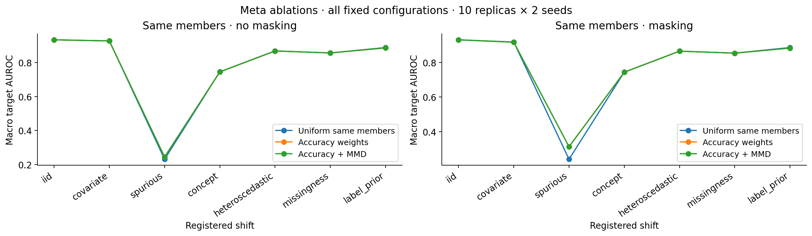
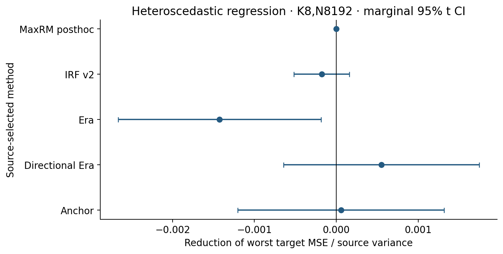

# Расширенное исследование Domain Generalization для ансамблей деревьев

Серия expanded_v2. Завершение анализа: 2026-11-05T06:57:16.910988+00:00. Протокол SHA-256 `4b57843c27bb871d6b4ee494715024b99e37b6730420029943836ab7288be7a8`. Code commit `bd3dca24a1387f066130f12289a8fb92e1de5ce0`.

## Основной результат

В предзаданном spurious-сценарии увеличение K4→K16 при N8192 снизило преимущество относительно собственного контроля: IRF v2 (classification) Δgain=-0.342194, Holm p=0.03125; Meta weights (classification) Δgain=-0.008859, Holm p=0.017578. Это вывод о конкретных source-selected pipelines и этом DGP, а не универсальное утверждение о числе доменов.

Для H2 подтверждающих результатов после Holm не получено; MaxRM regression H2 неполон и не считается выполненным тестом. Реальные задачи не дают одного универсального победителя DG. У IRF показано расхождение source/target ranking настроек; этот диагностический вывод не превращает target в данные настройки.

## 1. Что проверено

Зарегистрированы и предприняты 762 заданий: 757 полностью завершены; в 5 сохранены остальные заранее зарегистрированные методы при недоступном MaxRM. Сохранены 39,996 успешных обычных source fits и 875 повторов, 13,332 full-source конфигурации, 41,622 target-domain строк и 26,664 source-validation строк. Это retained successful fits; пилоты, диагностика и незавершённые вычисления не прибавлены к этому числу. Протокол опубликован в commit b0325a5 до первого нового target-доступа.

Первая серия проверена отдельными уравнениями и артефактами: все 1008 метрик, 126 моделей и 42 source fits подтвердились. Выявлены ограничения исторических пар MaxRM/Era/IRF/Meta. Полный разбор — [аудит v1](../audit_v1/audit_report.md). Это независимый способ проверки тем же авторским агентом, **не внешнее рецензирование другим исследователем**.

Итоговый аудит v2: статус **passed_with_input_and_numeric_qualifications**, независимо проверены 273,144 значений метрик и predictions 13,332 сохранённых конфигураций. Максимальное абсолютное расхождение метрик 2.66e-15, predictions 0. Проверены выбор конфигураций, пары, hashes, row IDs и последовательность source→receipt→target. [Машинные свидетельства](audit/final_integrity.json).

Пять MaxRM pipelines остановились на source с CLARABEL optimal_inaccurate. Точность solver не ослаблялась, запасная модель не подставлялась. Остальные исходно зарегистрированные методы завершены по открытому дополнению [source failures](../../docs/series_v2/source_failure_addendum.md). Из 18 основных тестов полностью исполнимы 17; H2 MaxRM regression содержит только 9 полных replica pairs и не объявляется подтверждающим тестом. Неуспешность относится к этой реализации/решателю/критерию сертификации, а не доказывает принципиальную неразрешимость MaxRM.

Численная проверка деревьев: leaves_below_registered_minimum=1, empty_nodes=1, nonfinite_nodes=1, regression_support_violations=9. Проверены фактические bootstrap partitions, а не только параметры конструктора. Source-only replay дополнительно выявил редкое нарушение min leaf в промежуточном Appliances CV-дереве при почти совпадающих floating-point календарных значениях; observed validation predictions конечны. Frozen код после открытия target не исправлялся. Это оговорка точности реализации; детали в source_numeric_diagnostic.json и audit/tree_numeric_checks.csv.

Отдельная реконструкция исходных CSV/ZIP подтвердила eligible rows, y и row IDs всех четырёх real tasks. Выявлен input-representation defect первого Beijing job: 357 пропусков wd представлены np.nan до cache и None после Parquet reload. При восстановлении исходной CSV-семантики полные векторы всех 17 моделей совпали с сохранёнными predictions точно; максимальное изменение per-domain RMSE при альтернативном cache-input для этих моделей равно 0.00197552 µg/m³. Официальные метрики не заменялись. Across-job Beijing comparisons имеют эту оговорку; synthetic H1/H2 этим случаем не затронуты. [Разбор ограничений реализации](../../docs/series_v2/implementation_findings.md), [raw-label audit](audit/raw_target_labels.json), [input provenance](audit/replay_input_provenance.json).

Все найденные full-source tree anomalies относятся к IRF на Appliances: девять нарушений фактической domain-support admissibility, включая один пустой leaf с NaN value. На сохранённых source/target observations predictions конечны и пересчитаны; корректность функции на произвольных новых входах этим не доказывается. IRF/Appliances pair differences нельзя интерпретировать как полностью чистый эффект заявленного penalty. В основных synthetic H1/H2 таких full-source нарушений не найдено.

## 2. Дизайн и область применимости

Синтетика: 33 условия ×10 независимых data replicas ×2 model seeds, семь типов сдвига (в regression нет pure label-prior). Основной screen K8,N8192; парные контрасты K4/K16 при одном N, N2048/N8192 при одном K, дисбаланс1/8 при тех же K/N. Target draws совпадают внутри предзаданных сравнений; независимая единица — data replica, не seed и не severity.

Реальные задачи: ACSIncome/PublicCoverage N4000/16000,K4/8, Beijing N2400/9600,K4/6, Appliances N2000/4000,K4/8 плюс N8000,K8. Три source resamples пересекаются и не являются независимыми real datasets. Новые targets: MN/OH/PA/OR/VA, четыре ранее не открытые Beijing stations и апрель/май одного дома. Старые targets v1 не использованы как новый независимый тест.

Пары разделяют исследуемый механизм и обучающую capacity: у Meta одни и те же trained members; у MaxRM те же bootstrap/ветви, только иные листья; у IRF/CRF одинаковы admissibility/RNG; Era сравнивается с domain-restricted pooled gain. Обычные RF/ExtraTrees/HistGBDT показаны отдельно. IRF v2 — зарегистрированный вариант с более строгими краевыми правилами; Meta — интерпретация. Это не точная репликация всех авторских экспериментов.

Полные настройки и математические объяснения: [пререгистрация](../../docs/series_v2/preregistration.md), [математическое приложение](../../docs/series_v2/mathematical_appendix.md). Source-validation включает две заранее заданные крайние среды; для Appliances — недели W09/W12 и embargo24h. Полного LODO по всем средам нет.

## 3. Основные H1/H2

H1: изменение преимущества DG относительно своего контроля при K16 против K4, N8192,balanced,spurious. H2: изменение этого преимущества при дисбалансе8:1 против равных сред, K8,N8192,spurious. Для каждой гипотезы — family из девяти method-task contrasts; двусторонний exact sign test по десяти data replicas, Holm отдельно в каждой family. Показанные t-CI — marginal 95%, без simultaneous correction.

Порог Holm .05 прошли 2 из 18 предзаданных тестов. Это свидетельство только для указанных generator/method/contrast, не универсальный закон DG.

- H1, classification, IRF v2: Δgain=-0.342194, 95% t-CI [-0.438199; -0.246189], sign p=0.0039062, Holm p=0.03125; ненулевых replicas 9.

- H1, classification, CRF: Δgain=0.000952, 95% t-CI [-0.013322; 0.015227], sign p=0.75391, Holm p=1; ненулевых replicas 10.

- H1, classification, Meta weights: Δgain=-0.008859, 95% t-CI [-0.012550; -0.005169], sign p=0.0019531, Holm p=0.017578; ненулевых replicas 10.

- H1, classification, Anchor: Δgain=0.000019, 95% t-CI [-0.002263; 0.002301], sign p=1, Holm p=1; ненулевых replicas 9.

- H1, regression, IRF v2: Δgain=0.005916, 95% t-CI [-0.029814; 0.041646], sign p=1, Holm p=1; ненулевых replicas 10.

- H1, regression, MaxRM posthoc: Δgain=-0.007694, 95% t-CI [-0.049790; 0.034403], sign p=0.75391, Holm p=1; ненулевых replicas 10.

- H1, regression, Era: Δgain=0.032437, 95% t-CI [0.003197; 0.061676], sign p=0.039062, Holm p=0.23438; ненулевых replicas 9.

- H1, regression, Directional Era: Δgain=0.489676, 95% t-CI [0.305406; 0.673947], sign p=0.021484, Holm p=0.15039; ненулевых replicas 10.

- H1, regression, Anchor: Δgain=0.025768, 95% t-CI [-0.014955; 0.066490], sign p=0.34375, Holm p=1; ненулевых replicas 10.

- H2, classification, IRF v2: Δgain=-0.069675, 95% t-CI [-0.267223; 0.127872], sign p=0.72656, Holm p=1; ненулевых replicas 8.

- H2, classification, CRF: Δgain=0.003895, 95% t-CI [-0.004902; 0.012691], sign p=0.75391, Holm p=1; ненулевых replicas 10.

- H2, classification, Meta weights: Δgain=-0.005424, 95% t-CI [-0.012940; 0.002091], sign p=0.75391, Holm p=1; ненулевых replicas 10.

- H2, classification, Anchor: Δgain=0.002115, 95% t-CI [-0.000266; 0.004496], sign p=0.125, Holm p=1; ненулевых replicas 7.

- H2, regression, IRF v2: Δgain=0.003514, 95% t-CI [-0.049859; 0.056886], sign p=0.75391, Holm p=1; ненулевых replicas 10.

- H2, regression, MaxRM posthoc: **не выполнен полностью**; 9 полных replicas вместо 10. Descriptive complete-case Δgain=-0.00589066, t-CI [-0.080426; 0.0686447]. Confirmatory p не объявляется; для коррекции остальных сохранена family=9 с консервативным input p=1.

- H2, regression, Era: Δgain=0.000426, 95% t-CI [-0.035058; 0.035910], sign p=0.75391, Holm p=1; ненулевых replicas 10.

- H2, regression, Directional Era: Δgain=0.025503, 95% t-CI [-0.086352; 0.137359], sign p=1, Holm p=1; ненулевых replicas 10.

- H2, regression, Anchor: Δgain=-0.000936, 95% t-CI [-0.059908; 0.058036], sign p=0.72656, Holm p=1; ненулевых replicas 8.

## 4. Механизмы сдвига и фиксированные кривые

Положительный gain означает улучшение относительно собственного нулевого контроля: ΔAUROC для binary и уменьшение MSE/source variance для regression. Нулевой gain часто означает source-selected отказ от регуляризации; это допустимый результат, а не пропущенный запуск. Степени severity равно взвешены. Внешний сильный baseline может оказаться лучше обеих моделей пары.

classification, **concept**: Anchor +0.0000 [-0.0001;+0.0002]; CRF -0.0000 [-0.0009;+0.0009]; IRF v2 +0.0000 [+0.0000;+0.0000]; Meta weights -0.0004 [-0.0009;+0.0000]; Meta + masking +0.0001 [-0.0007;+0.0009]. Интервалы descriptive marginal, без поправки на все secondary comparisons.

classification, **covariate**: Anchor -0.0003 [-0.0007;+0.0001]; CRF +0.0018 [-0.0019;+0.0055]; IRF v2 -0.0018 [-0.0053;+0.0017]; Meta weights -0.0004 [-0.0011;+0.0002]; Meta + masking -0.0006 [-0.0026;+0.0015]. Интервалы descriptive marginal, без поправки на все secondary comparisons.

classification, **heteroscedastic**: Anchor -0.0000 [-0.0003;+0.0003]; CRF +0.0010 [-0.0004;+0.0023]; IRF v2 +0.0000 [+0.0000;+0.0000]; Meta weights -0.0002 [-0.0004;+0.0001]; Meta + masking +0.0003 [-0.0003;+0.0009]. Интервалы descriptive marginal, без поправки на все secondary comparisons.

classification, **iid**: Anchor -0.0001 [-0.0003;+0.0000]; CRF +0.0005 [-0.0011;+0.0020]; IRF v2 +0.0016 [-0.0009;+0.0041]; Meta weights -0.0000 [-0.0001;+0.0001]; Meta + masking -0.0002 [-0.0008;+0.0003]. Интервалы descriptive marginal, без поправки на все secondary comparisons.

classification, **label_prior**: Anchor +0.0000 [-0.0003;+0.0003]; CRF -0.0002 [-0.0022;+0.0019]; IRF v2 -0.0015 [-0.0044;+0.0014]; Meta weights -0.0001 [-0.0003;+0.0001]; Meta + masking -0.0003 [-0.0006;+0.0000]. Интервалы descriptive marginal, без поправки на все secondary comparisons.

classification, **missingness**: Anchor -0.0001 [-0.0004;+0.0002]; CRF +0.0020 [-0.0006;+0.0047]; IRF v2 +0.0013 [-0.0037;+0.0062]; Meta weights +0.0000 [-0.0001;+0.0001]; Meta + masking -0.0002 [-0.0007;+0.0002]. Интервалы descriptive marginal, без поправки на все secondary comparisons.

classification, **spurious**: Anchor -0.0015 [-0.0025;-0.0005]; CRF -0.0028 [-0.0100;+0.0044]; IRF v2 +0.1482 [+0.0189;+0.2776]; Meta weights +0.0136 [+0.0059;+0.0213]; Meta + masking +0.0629 [+0.0381;+0.0877]. Интервалы descriptive marginal, без поправки на все secondary comparisons.

regression, **concept**: Anchor +0.0000 [-0.0008;+0.0008]; Directional Era -0.0001 [-0.0005;+0.0003]; Era -0.0001 [-0.0004;+0.0001]; IRF v2 -0.0010 [-0.0020;-0.0001]; MaxRM posthoc -0.0006 [-0.0014;+0.0002]. Интервалы descriptive marginal, без поправки на все secondary comparisons.

regression, **covariate**: Anchor -0.0002 [-0.0007;+0.0003]; Directional Era -0.0000 [-0.0002;+0.0002]; Era +0.0001 [-0.0001;+0.0002]; IRF v2 -0.0001 [-0.0006;+0.0005]; MaxRM posthoc +0.0001 [-0.0001;+0.0003]. Интервалы descriptive marginal, без поправки на все secondary comparisons.

regression, **heteroscedastic**: Anchor +0.0000 [-0.0005;+0.0005]; Directional Era +0.0004 [-0.0001;+0.0010]; Era -0.0007 [-0.0014;-0.0001]; IRF v2 -0.0001 [-0.0003;+0.0001]; MaxRM posthoc +0.0000 [+0.0000;+0.0000]. Интервалы descriptive marginal, без поправки на все secondary comparisons.

regression, **iid**: Anchor +0.0000 [-0.0002;+0.0002]; Directional Era -0.0001 [-0.0006;+0.0004]; Era -0.0003 [-0.0006;+0.0000]; IRF v2 -0.0001 [-0.0003;+0.0001]; MaxRM posthoc -0.0000 [-0.0001;+0.0001]. Интервалы descriptive marginal, без поправки на все secondary comparisons.

regression, **missingness**: Anchor +0.0001 [-0.0004;+0.0005]; Directional Era +0.0002 [-0.0002;+0.0006]; Era -0.0006 [-0.0017;+0.0004]; IRF v2 -0.0002 [-0.0005;+0.0002]; MaxRM posthoc -0.0001 [-0.0002;+0.0001]. Интервалы descriptive marginal, без поправки на все secondary comparisons.

regression, **spurious**: Anchor -0.0221 [-0.0562;+0.0120]; Directional Era +0.6485 [+0.6119;+0.6851]; Era -0.0430 [-0.0734;-0.0126]; IRF v2 +0.0447 [+0.0134;+0.0760]; MaxRM posthoc -0.0034 [-0.0676;+0.0609]. Интервалы descriptive marginal, без поправки на все secondary comparisons.

## 5. Число сред, размер выборки и дисбаланс

H1 изолирует число сред при одном общем N и неизменных границах source-параметра. Каждая среда при большем K становится меньше; именно такой tradeoff проверяет дизайн. H3 меняет только N при K8, H2 — только распределение размеров при одинаковом K/N. Большой K не автоматически означает больше информации о стабильном механизме.

Для H3 результаты являются вторичными; exact paired effects/CI находятся в tables/secondary_N_contrasts.csv. Нормировка риска основана на source variance каждого условия; рядом сохранены исходные MSE/RMSE, чтобы видеть изменение масштаба.

## 6. Новые реальные домены

Ниже — описательный срез максимальных N и K каждой задачи. Порядок по target — ретроспективное представление уже зафиксированных pipelines, не процедура выбора будущего метода. Малое число зависимых доменов и overlapping source resamples не поддерживает популяционные p-values.

**ACSIncome**, N=16000,K=8; AUROC ↑: Anchor: 0.86821; HistGBDT 200: 0.86794; RF 200: 0.86657; Meta weights: 0.85226; Meta + masking: 0.84989; ExtraTrees 200: 0.84938; CRF: 0.79845; IRF v2: 0.79700.

Matched gains: Anchor +0.00000; CRF -0.00018; IRF v2 +0.00000; Meta weights -0.00084; Meta + masking -0.00074. Это means по трём source resamples и двум seeds; CI независимых datasets не рассчитывается.

**ACSPublicCoverage**, N=16000,K=8; AUROC ↑: HistGBDT 200: 0.81816; Anchor: 0.81750; RF 200: 0.81404; ExtraTrees 200: 0.79874; Meta + masking: 0.77628; Meta weights: 0.77524; CRF: 0.70435; IRF v2: 0.69200.

Matched gains: Anchor +0.00000; CRF +0.01589; IRF v2 +0.00000; Meta weights -0.00036; Meta + masking +0.00063. Это means по трём source resamples и двум seeds; CI независимых datasets не рассчитывается.

**Beijing PM2.5**, N=9600,K=6; macro RMSE ↓: HistGBDT 200: 24.00597; ExtraTrees 200: 25.68444; Anchor: 25.71086; RF 200: 25.80262; Directional Era: 28.46810; Era: 28.47715; MaxRM posthoc: 30.63750; IRF v2: 30.66250.

Matched gains: Anchor +0.00059; Directional Era -0.00017; Era -0.00026; IRF v2 -0.00013; MaxRM posthoc -0.00050. Это means по трём source resamples и двум seeds; CI независимых datasets не рассчитывается.

**Appliances (один дом)**, N=8000,K=8; macro RMSE ↓: Era: 90.63244; Directional Era: 90.91958; IRF v2: 91.42354; MaxRM posthoc: 93.16629; ExtraTrees 200: 93.87626; HistGBDT 200: 96.74091; Anchor: 97.34449; RF 200: 100.17629.

Matched gains: Anchor +0.00724; Directional Era -0.00265; Era +0.00295; IRF v2 +0.00098; MaxRM posthoc +0.00096. Это means по трём source resamples и двум seeds; CI независимых datasets не рассчитывается.

Beijing — contemporaneous PM2.5 modelling с PM10/синхронными загрязнителями, не forecast. Станции разделяют погоду и временную ось. Appliances — перенос на будущее одного дома, не на новые дома; локальные T6/RH6 расположены снаружи у здания. ACSIncome/PublicCoverage используют один survey family и невзвешенные rows; результаты не являются survey-weighted population estimates.

## 7. Source selection, Meta и неодинаковый шум

Для каждого frozen grid сохранены все target points. Разница с best-on-target grid point — retrospective oracle diagnostic: она показывает потерю source selection, но oracle нельзя выдавать за deployable pipeline. При единственном grid point такой gap тождественно нулевой и не свидетельствует о лучшей selection.

### H5: конкретный случай смены source-выбора IRF

При K4 source-validation выбрала λ=.05 в 18 из 20 запусков; при K16 выбрала λ=0 в 20 из 20. При K16 mean source AUROC для λ0=0.965664, для λ.05=0.932915; mean target AUROC соответственно 0.365172 и 0.815715. Это наблюдаемый механизм потери source-selected pipeline: он отказался от ненулевого штрафа, хотя зарегистрированная фиксированная точка лучше на данном target reversal. Поэтому отрицательный H1 для pipeline не равен доказательству, что каждый фиксированный регуляризованный IRF хуже при большем K. Эта secondary диагностика объясняет полученные результаты; выбор новой λ по открытому target потребовал бы нового независимого теста.

Meta uniform/accuracy/full сравниваются на буквально одинаковых forest members. Full-minus-accuracy изолирует добавление MMD в этой интерпретации, а masked/unmasked — отдельную политику признаков. Маскирование и MMD не объявляются полезными заранее.

Heteroscedastic regression имеет точно известный неустранимый target noise MSE примерно .192,1,5.207. Worst-risk оптимизация может расходовать свободу на наиболее шумную среду, не получая устойчивую среднюю функцию. Это проверяется по mean и worst target risk; per-tree bootstrap risk certificate MaxRM не является target или ensemble guarantee.

## 8. Что можно и нельзя заключать

Численная корректность и сопоставимость controls проверяются отдельно от научного выигрыша. Отрицательный результат на selected pipeline не доказывает бесполезность всей статьи, особенно при независимой реализации/ограниченной capacity. Положительный secondary effect не становится confirmatory из-за красивого графика. Сдвиг условного механизма может разрушать предпосылку общей invariant функции; никаких гарантий произвольного OOD здесь нет.

10 MC replicas описывают неопределённость внутри этих DGP, а не выборку всех табличных задач. Две крайние source folds экономят вычисления, но могут пропускать внутренние механизмы. Folds, grids, severity и новые targets нельзя менять по этим результатам и снова называть те же targets независимым финалом. Дальнейшие решения потребуют нового зарегистрированного holdout либо честного exploratory статуса.

Логическая цепочка hashes/receipts усилена и проверена; OS-аудита любого возможного ручного чтения нет. Нельзя превращать локальные timestamps в абсолютное доказательство исторического отсутствия доступа. Полные версии, source fingerprints, frozen runtime и journal доступны в репозитории; raw data/models/predictions локальные и исключены из Git.

## 9. Где полный материал

- [Интерактивный локальный читатель](index.html): фильтры по задаче, сценарию, K/N, все summary metrics.
- [Исходные per-domain метрики](tables/target_metrics.csv) и [source-CV](tables/source_cv_metrics.csv).
- [Основные тесты](tables/hypothesis_tests.csv), [10 paired contrasts каждого теста](tables/hypothesis_replica_contrasts.csv).
- [Все frozen points и matched gains](tables/all_grid_paired_effects.csv), [выбор конфигураций](tables/configuration_selection_frequency.csv).
- [Выбор и oracle diagnostic](tables/selection_diagnostics.csv), [инвентарь](analysis_inventory.json), [аудит](audit/final_integrity.json).
- Локально runs/expanded_v2/models и predictions: полные модели/исходные predictions; в Git только reports, configurations, hashes и журналы.
- Полные тексты литературы локально literature/pdfs; ссылки/версии/недоступные тексты — literature/sources.json, download_manifest.json, docs/literature_audit.md.
