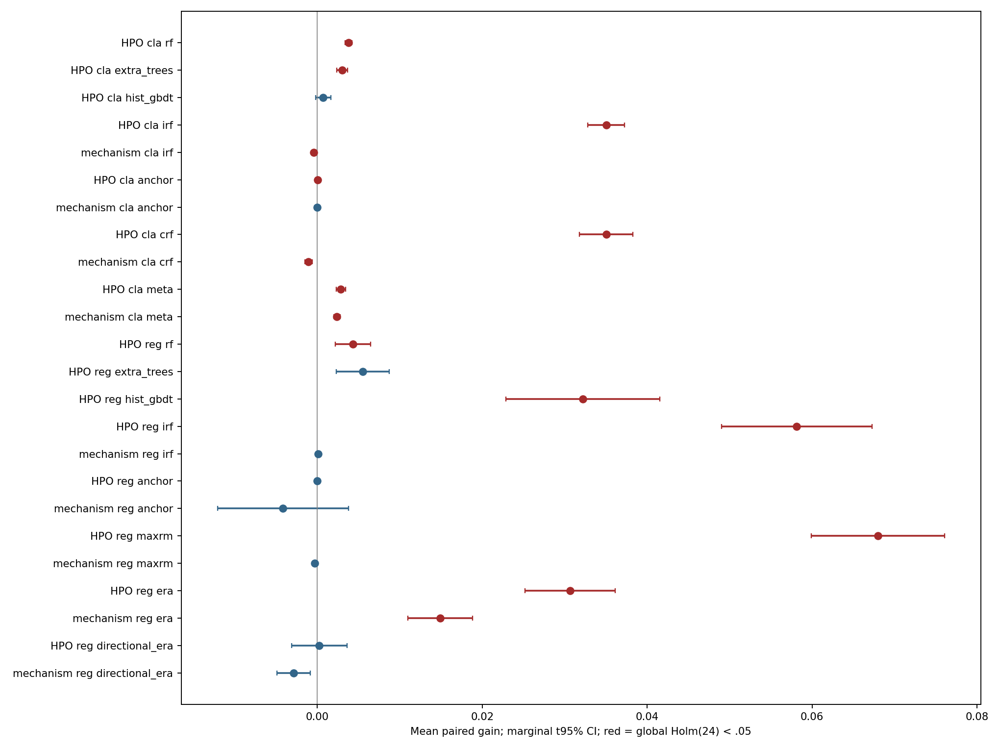

# Углублённая настройка и свежий финальный тест v4

## Выполненный дизайн

Все методы и strong baselines получили предзаданные пространства гиперпараметров: screening и full-capacity проверка по source domains, без target выбора. Полный дизайн и численные бюджеты: [source protocol](../../runs/tuned_v4/source_protocol.json). Итоговые выбранные настройки, source files и final source models зафиксированы до открытия targets: [final protocol](../../runs/tuned_v4/final_protocol.json). [Source selection](source_selection.csv), [все source trials и длительности](source_trials.csv).

HPO выбиралась один раз на development source каждого контекста. Затем параметры переносились на новые, более крупные source draws. Это оценка заранее настроенных pipelines, а не повтор настройки в каждой MC replica. Предел качества каждого метода и равные CPU budgets не заявляются. Референс использует исправленные реализации и ограниченный исходный grid; это новый контроль, а не подмена исторических v1/v2.

## Итоговые артефакты

Завершено jobs: 272; target-domain metric rows: 16200. Основных тестов: 24, завершены: 24; Holm-significant: 15. Источник каждого числа: [final integrity](final_integrity.json), [таблица тестов](hypothesis_tests.csv), [replica contrasts](replica_contrasts.csv). Статусы пропусков нельзя заменять нулями или игнорировать при complete-case тестировании.

## Как читать статистику

HPO = tuned − source-selected restricted reference; mechanism = tuned − own matched-capacity control. Для classification используется разность AUROC; для regression — разность MSE с обратным знаком, делённая на full-source variance. Сначала macro target domains и model seeds, затем равновесное усреднение зарегистрированных сценариев внутри независимой MC replica. Exact two-sided sign test проверяет знаки, не нулевое среднее; нулевые contrasts исключаются. Один Holm family охватывает все основные тесты. CI — маргинальный t интервал среднего, не simultaneous CI. [Статистика и filters](hypothesis_tests.csv), [исходные per-domain метрики](target_metrics.csv).

## Ограничения и интерпретация

Свежие synthetic draws независимы от прежних draw, но относятся к уже известным механизмам. Это не подтверждение на новой семье реальных задач. ACSIncome/PublicCoverage используют одни новые штаты и принадлежат одной survey family; source resamples перекрываются, поэтому real результаты описательные. Для Beijing/Appliances выполнена source настройка, нового независимого real target в прежних данных нет. Старые v1/v2 targets не использовались.

Положительный HPO contrast показывает пользу данного source-only поиска при заданном бюджете; отрицательный — возможную ошибку переноса source ranking или избыточную capacity. Отсутствие значимости не доказывает эквивалентности. Mechanism gains не следует путать с победой над strong baselines: [source-selected baseline comparison](strong_baseline_gains.csv). Meta остаётся интерпретацией, IRF/CRF/MaxRM — независимыми реализациями, не точными репликациями авторских экспериментов.

Алгоритмы и выбранные настройки после target доступа не менялись. Сохраняются исходные failures, source receipts, матричные hashes и predictions. Локальные timestamps и hashes не являются OS-level независимым доказательством отсутствия любого ручного доступа. Полные predictions/models локальны; в Git находятся протоколы, таблицы, реестр hashes и отчёт.
